# UTS Network Security — Kasus 5

**NIM:** 24552011258  
**Kasus:** 5

## Daftar Isi

- [Tugas 1 — Docker dan Volume](#tugas-1--docker-dan-volume)
- [Tugas 2 — Enkripsi dan Sertifikat](#tugas-2--enkripsi-dan-sertifikat)
- [Tugas 3 — ARP Spoofing](#tugas-3--arp-spoofing)
- [Tugas 4 — WPA2 Handshake](#tugas-4--wpa2-handshake)
- [Tugas 5 — ICMP dengan Scapy](#tugas-5--icmp-dengan-scapy)
- [Tugas 6 — TCP dan SYN Flood](#tugas-6--tcp-dan-syn-flood)
- [Tugas 7 — DNS dan Analisis Log](#tugas-7--dns-dan-analisis-log)

---

# Tugas 1 — Docker dan Volume

## A. Docker Volume

Pada pengujian ini dibuat Docker volume dengan nama `vol-k5`. Volume digunakan untuk menyimpan file `laporan-k5.txt` yang berisi NIM.

Setelah file berhasil dibuat, container yang digunakan dihapus. Kemudian file dibaca kembali menggunakan container baru.

Hasilnya, isi file tetap tersimpan meskipun container sebelumnya sudah dihapus. Hal ini menunjukkan bahwa Docker volume dapat menyimpan data secara persisten.

### Command
```bash
docker volume create vol-k5
docker run --name w-k5 -v vol-k5:/data alpine sh -c 'echo NIM-ANDA > /data/laporan-k5.txt'
docker rm w-k5
docker run --rm -v vol-k5:/data alpine cat /data/laporan-k5.txt
```

### Screenshot

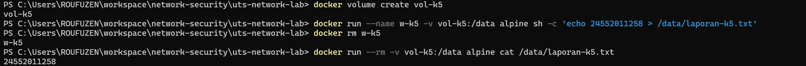

## B. Docker Compose

Docker Compose digunakan untuk menjalankan container attacker dan target secara bersamaan.

### Command
```bash
docker compose -p k5 -f b/b1-compose/docker-compose.yml up -d
docker compose -p k5 -f b/b1-compose/docker-compose.yml exec attacker wget -qO- http://target
docker compose -p k5 -f b/b1-compose/docker-compose.yml down -v
```

Hasil pengujian menampilkan halaman Welcome to nginx. Ini menunjukkan bahwa attacker berhasil mengakses layanan web pada container target melalui jaringan Docker.

Setelah pengujian selesai, container dan network dihentikan menggunakan Docker Compose.

### Screenshot

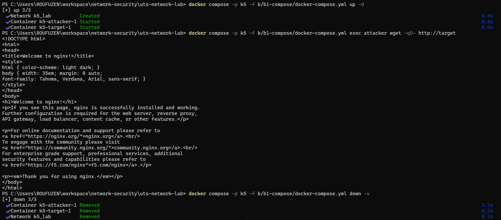

## Kesimpulan

Docker volume dapat digunakan untuk menyimpan data agar tetap tersedia meskipun container dihapus. Docker Compose juga memudahkan pengelolaan beberapa container dan komunikasi antarlayanan dalam satu jaringan.

---

# Tugas 2 — Enkripsi dan Sertifikat

## A. Enkripsi dan Dekripsi AES

Pada pengujian ini digunakan algoritma AES-256-CBC untuk melakukan enkripsi dan dekripsi file.

Proses enkripsi menggunakan PBKDF2 sebagai metode derivasi kunci. Setelah proses dekripsi dilakukan, hash SHA-256 dari file asli dan file hasil dekripsi dibandingkan.

Hasil hash yang diperoleh:

```text
22e90e5baa6048f9871927be4fa8af9d141b10a1071cf2b975272db8343f79b
```

Kedua hash memiliki nilai yang sama. Artinya, file hasil dekripsi sesuai dengan file aslinya.

### Command
```bash
docker run --rm -v "$PWD":/work uts-openssl sh -c 'echo isi laporan k5 > laporan-k5.txt && openssl enc -aes-256-cbc -pbkdf2 -salt -in laporan-k5.txt -out laporan-k5.enc -pass pass:kunci-k5-2026 && sha256sum laporan-k5.txt && openssl enc -d -aes-256-cbc -pbkdf2 -in laporan-k5.enc -out hasil-k5.txt -pass pass:kunci-k5-2026 && sha256sum hasil-k5.txt'
```

### Screenshot

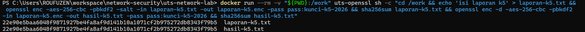

## B. Sertifikat Digital

Pada tahap ini dibuat sertifikat digital menggunakan RSA dengan ukuran kunci 2048 bit.

Sertifikat dibuat menggunakan OpenSSL dengan informasi berikut:

- Subject: `CN=k5.uts.local`
- Issuer: `CN=k5.uts.local`
- Algoritma: RSA 2048
- Masa berlaku: 30 hari

Sertifikat yang digunakan merupakan self-signed certificate, yaitu sertifikat yang ditandatangani oleh pembuatnya sendiri.

### Command
```bash
docker run --rm -v "$PWD":/work uts-openssl sh -c 'openssl req -x509 -newkey rsa:2048 -nodes -keyout key-k5.pem -out cert-k5.pem -days 30 -subj /CN=k5.uts.local && openssl x509 -in cert-k5.pem -noout -subject -issuer -dates'
```

### Screenshot

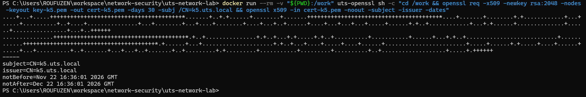

## Kesimpulan

Enkripsi AES digunakan untuk menjaga kerahasiaan data, sedangkan proses dekripsi digunakan untuk mengembalikan data ke bentuk semula.

Perbandingan hash SHA-256 menunjukkan bahwa hasil dekripsi sesuai dengan file asli. Sertifikat digital digunakan untuk menunjukkan identitas dalam komunikasi digital.

---

# Tugas 3 — ARP Spoofing

## A. Persiapan Container

Pada praktikum ini dibuat tiga container, yaitu:

- `korban-k5`
- `gateway-k5`
- `penyerang-k5`

Ketiga container dihubungkan melalui network Docker bernama `lab-arp-k5`.

### Command
```bash
docker network create lab-arp-k5
docker run -d --name korban-k5 --network lab-arp-k5 --cap-add NET_ADMIN uts-kali-tools
docker run -d --name gateway-k5 --network lab-arp-k5 --cap-add NET_ADMIN uts-kali-tools
docker run -d --name penyerang-k5 --network lab-arp-k5 --cap-add NET_ADMIN uts-kali-tools
```

### Screenshot

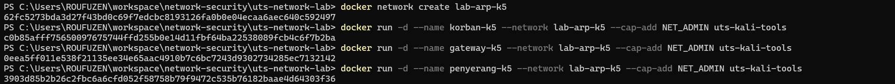

## B. Kondisi Sebelum Spoofing

Sebelum pengujian dilakukan, tabel ARP pada container korban diperiksa untuk mengetahui pemetaan IP address dan MAC address gateway.

Alamat gateway yang diamati adalah `172.18.0.3`.

### Command
```bash
docker exec korban-k5 arp -a
```

### Screenshot

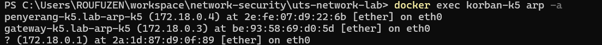

## C. Perubahan MAC Address Gateway

Setelah pengujian ARP spoofing dilakukan, terjadi perubahan pemetaan MAC address pada tabel ARP korban.

Sebelumnya IP gateway menggunakan MAC address asli:

```text
be:93:58:69:d0:5d
```

Setelah spoofing, pemetaan berubah menjadi MAC address penyerang:

```text
2e:fe:07:d9:22:6b
```

Perubahan ini menunjukkan bahwa informasi ARP dapat dimanipulasi oleh perangkat lain dalam jaringan lokal.

### Command
```bash
docker exec -d penyerang-k5 timeout 20 arpspoof -i eth0 -t <ip-korban> <ip-gateway>
docker exec korban-k5 arp -a
```

### Screenshot

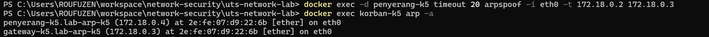

## D. Mitigasi ARP Spoofing

Setelah pengujian selesai, dilakukan mitigasi menggunakan static ARP.

Pemetaan IP gateway dikembalikan ke MAC address aslinya dan status entri berubah menjadi `PERM`.

### Command
```bash
docker exec korban-k5 arp -s <ip-gateway> $(docker exec gateway-k5 cat /sys/class/net/eth0/address)
docker exec korban-k5 arp -a
```

### Screenshot

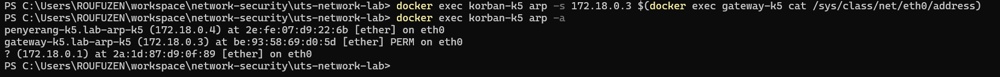

## Kesimpulan

ARP spoofing dapat mengubah pemetaan IP address dan MAC address pada jaringan lokal.

Penggunaan static ARP dapat membantu mencegah perubahan pemetaan pada entri yang telah dikunci.

---

# Tugas 4 — WPA2 Handshake

### Perintah yang Digunakan

Menjalankan Aircrack-ng:

```cmd
docker run --rm -v "%cd%:/work" -w /work uts-kali-tools aircrack-ng -w wordlist-k5.txt handshake-k5.cap
```

Memeriksa file capture menggunakan tcpdump:

```cmd
docker run --rm -v "%cd%:/work" -w /work uts-kali-tools tcpdump -r handshake-k5.cap -c 5
```

Memeriksa header dan panjang paket PCAP:

```cmd
docker run --rm -v "%cd%:/work" -w /work uts-kali-tools python3 -c "import struct; f=open('handshake-k5.cap','rb'); h=f.read(24); print('PCAP header:', h.hex()); print('Magic:', h[:4].hex()); print('Link type:', struct.unpack('<I',h[20:24])[0]); p=f.read(16); print('Packet header:', p.hex()); print('Captured length:', struct.unpack('<I',p[8:12])[0]); print('Original length:', struct.unpack('<I',p[12:16])[0])"
```

### Hasil

Aircrack-ng tidak berhasil menemukan jaringan dari file `handshake-k5.cap`. Output yang diperoleh:


Hasil pemeriksaan header PCAP menunjukkan:


Berdasarkan hasil tersebut, file capture tidak dapat dibaca sebagai capture Wi-Fi 802.11 yang valid. Panjang paket yang tercatat juga tidak sesuai dengan ukuran file.

### Penjelasan Empat Langkah Handshake WPA2

1. **Message 1:** Access Point mengirim ANonce kepada client.
2. **Message 2:** Client mengirim SNonce dan MIC kepada Access Point.
3. **Message 3:** Access Point mengirim konfigurasi kunci terenkripsi beserta MIC.
4. **Message 4:** Client mengirim konfirmasi bahwa proses pemasangan kunci berhasil.

### Kesimpulan

Pengujian handshake WPA2 belum berhasil dilakukan karena file capture bawaan penguji tidak valid untuk dianalisis. Hasil `KEY FOUND` maupun `KEY NOT FOUND` belum dapat ditentukan. Diperlukan file capture pengganti yang valid untuk melanjutkan pengujian.

---

# Tugas 5 — ICMP dengan Scapy

## Tujuan

Pengujian ini dilakukan untuk memahami komunikasi ICMP antara dua container menggunakan Scapy.

## Hasil Pengujian

Paket ICMP Echo Request dikirim dari container penyerang menuju container korban dengan alamat IP:

```text
172.18.0.2
```

Hasil pengujian menunjukkan:

```text
TTL balasan: 64
Tipe ICMP balasan: 0
```

Tipe ICMP 0 merupakan Echo Reply, yaitu balasan dari Echo Request yang dikirim sebelumnya.

### Command

```bash
docker run --rm --network lab-arp-k5 -v "$PWD/kasus/k5-scapy:/work" uts-kali-tools python3 /work/kirim_icmp.py <ip-korban>
```

### Screenshot

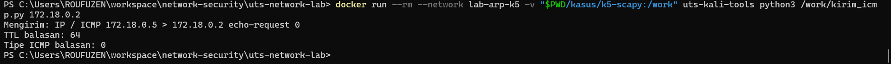

## Penjelasan

ICMP Echo Request menggunakan tipe 8, sedangkan ICMP Echo Reply menggunakan tipe 0.

Smurf attack merupakan salah satu serangan denial-of-service yang memanfaatkan ICMP dan mekanisme amplifikasi untuk menghasilkan trafik menuju korban.

Pada praktikum ini dilakukan pengujian komunikasi ICMP biasa menggunakan Scapy, bukan menjalankan Smurf attack.

## Kesimpulan

Pengujian berhasil menunjukkan bahwa komunikasi ICMP antara container penyerang dan korban berjalan dengan baik. Hal ini dibuktikan dengan diterimanya paket Echo Reply dengan TTL 64.

---

# Tugas 6 — TCP Three-Way Handshake dan SYN Flood

## A. Menjalankan Docker Compose

Docker Compose digunakan untuk menjalankan container attacker dan target pada jaringan lab.

### Screenshot

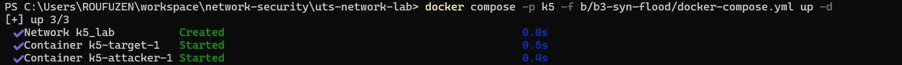

## B. Pemeriksaan Sebelum Pengujian

Sebelum pengamatan trafik dilakukan, jumlah koneksi dengan status `SYN_RECV` diperiksa pada container target.

Hasil pemeriksaan menunjukkan nilai:

```text
0
```

Artinya, tidak ditemukan koneksi dengan status SYN_RECV pada saat pemeriksaan awal.

### Command

```bash
docker compose -p k5 -f b/b3-syn-flood/docker-compose.yml up -d
docker compose -p k5 -f b/b3-syn-flood/docker-compose.yml exec target netstat -ant | grep -c SYN_RECV
docker compose -p k5 -f b/b3-syn-flood/docker-compose.yml exec -d attacker timeout 15 hping3 -S -p 80 --flood target
```

### Screenshot

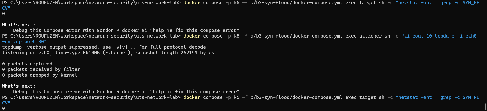

## C. Pengamatan TCP

Pengamatan dilakukan menggunakan tcpdump dengan filter TCP port 80.

Hasil capture menunjukkan proses three-way handshake antara:

- Attacker: `172.19.0.2`
- Target: `172.19.0.3`

Urutan prosesnya adalah:

1. Client mengirim paket SYN.
2. Server membalas dengan SYN-ACK.
3. Client mengirim ACK.

Setelah koneksi terbentuk, client mengirim HTTP GET dan menerima respons:

```text
HTTP/1.1 200 OK
```

Hasil capture menunjukkan:

```text
12 packets captured
12 packets received by filter
0 packets dropped by kernel
```

### Command

```bash
docker compose -p k5 -f b/b3-syn-flood/docker-compose.yml exec attacker sh -c 'timeout 10 tcpdump -i eth0 -nn tcp port 80 & sleep 1; curl -s http://target > /dev/null; sleep 10'
docker compose -p k5 -f b/b3-syn-flood/docker-compose.yml down -v
```
### Screenshot

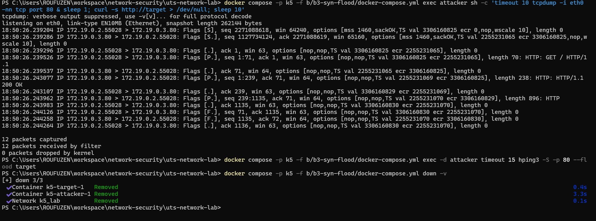

## Penjelasan

TCP three-way handshake merupakan proses pembentukan koneksi antara client dan server.

SYN flood merupakan serangan yang mengeksploitasi proses pembentukan koneksi TCP dengan mengirim banyak permintaan koneksi yang tidak diselesaikan.

Pengujian yang dilakukan pada praktikum ini menunjukkan komunikasi TCP normal dan proses three-way handshake. Kondisi SYN flood belum berhasil dibuktikan melalui capture.

## Kesimpulan

Pengujian berhasil memperlihatkan proses three-way handshake TCP dan komunikasi HTTP antara attacker dan target. Hasil tersebut menunjukkan bahwa layanan web dapat diakses dengan baik melalui jaringan Docker.

---

# Tugas 7 — DNS dan Analisis Log

## A. Menjalankan Docker Compose

Pada tahap pertama, Docker Compose digunakan untuk menjalankan container attacker dan DNS server.

Perintah yang digunakan:

```powershell
docker compose -p k5 -f b/b4-dns-exfil/docker-compose.yml up -d
```

Container attacker dan DNS berhasil dijalankan.

### Screenshot

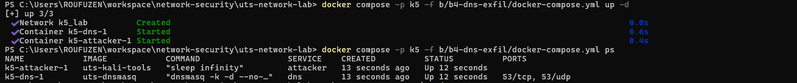

## B. Konversi NIM ke Hexadecimal dan Query DNS

Tahap berikutnya dilakukan melalui terminal attacker.

Pertama, diperiksa ketersediaan perintah `xxd` menggunakan:

```bash
which xxd
```

Setelah tersedia, NIM dikonversi menjadi hexadecimal menggunakan:

```bash
echo -n "24552011258" | xxd -p
```

Hasil konversi:

```text
3234353532303131323538
```

Hexadecimal tersebut merupakan representasi teks NIM dalam bentuk hexadecimal.

Setelah proses pada terminal attacker selesai, dilakukan pengamatan query DNS menggunakan DNS server pada jaringan lab.

### Screenshot

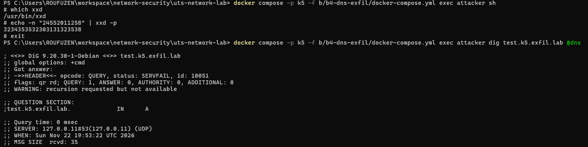

## C. Pemeriksaan Log dnsmasq

Sebelum melakukan capture paket, log DNS server diperiksa terlebih dahulu.

Log awal menunjukkan bahwa dnsmasq berhasil berjalan dengan versi 2.90.

Beberapa informasi yang terlihat:

- DNS service berjalan pada jaringan lokal.
- dnsmasq membaca file `/etc/hosts`.
- Belum terdapat catatan capture paket pada tampilan log awal.

### Screenshot

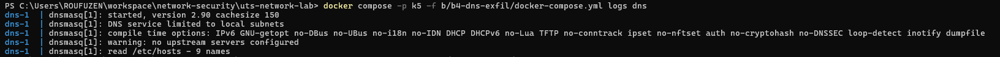

## D. Capture Paket DNS

Pengamatan paket dilakukan menggunakan tcpdump pada container attacker.

Pengujian query DNS biasa dilakukan terhadap domain:

```text
test.k5.exfil.lab
```

Hasil pengujian menunjukkan:

```text
status: NOERROR
IP address: 10.0.0.99
```

Hasil capture tcpdump:

```text
2 packets captured
2 packets received by filter
0 packets dropped by kernel
```

Dua paket yang tertangkap merupakan DNS query dan DNS response.

Setelah capture selesai, log DNS diperiksa kembali. dnsmasq mencatat query yang berasal dari IP `172.19.0.2` menuju domain `test.k5.exfil.lab`.

Contoh log:

```text
query[A] test.k5.exfil.lab from 172.19.0.2
config test.k5.exfil.lab is 10.0.0.99
```

### Screenshot

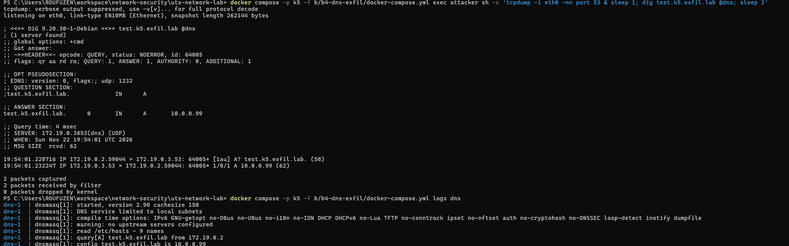

## E. Menyimpan Log dan Decode Hexadecimal

Setelah pengujian selesai, log DNS disimpan ke dalam file bernama:

```text
dns-k5.log
```

File tersebut digunakan sebagai bahan dokumentasi dan analisis aktivitas DNS.

Hexadecimal yang diperoleh dari NIM juga dapat dikonversi kembali menjadi teks menggunakan perintah:

```bash
echo "3234353532303131323538" | xxd -r -p
```

Hasil decode:

```text
24552011258
```

Hasil tersebut sesuai dengan NIM awal.

### Screenshot

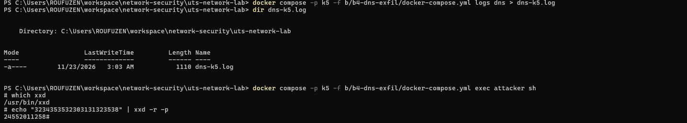

## Analisis DNS

DNS dapat disalahgunakan sebagai media komunikasi untuk membawa data melalui label nama domain.

Beberapa indikator yang dapat diamati untuk mendeteksi aktivitas DNS yang mencurigakan adalah:

- Subdomain yang terlalu panjang.
- Banyak variasi subdomain pada satu domain utama.
- Frekuensi query DNS yang tidak biasa.
- Label domain yang menyerupai format encoding seperti hexadecimal atau Base32.
- Query berulang dalam waktu singkat.

Pola tersebut dapat digunakan sebagai indikator awal untuk mengidentifikasi kemungkinan aktivitas DNS tunneling atau DNS exfiltration.

## Kesimpulan

Pengujian berhasil menunjukkan komunikasi DNS antara container attacker dan DNS server. Query DNS berhasil mendapatkan respons, paket berhasil ditangkap menggunakan tcpdump, dan aktivitas query tercatat pada log dnsmasq.

Konversi NIM ke hexadecimal dan proses decode kembali juga menunjukkan bahwa data dapat direpresentasikan dalam bentuk hexadecimal.

---

# Kesimpulan Umum

Berdasarkan seluruh praktikum UTS Network Security Kasus 5, dapat dipahami beberapa konsep keamanan jaringan, mulai dari penggunaan Docker dan volume, enkripsi AES, sertifikat digital, ARP spoofing, komunikasi ICMP, TCP three-way handshake, hingga pengamatan dan analisis DNS.

Setiap praktikum memberikan pemahaman mengenai cara kerja jaringan, kemungkinan celah keamanan, serta metode pengamatan dan mitigasi yang dapat dilakukan.

Beberapa bagian pengujian, seperti WPA2 handshake dan simulasi SYN flood, belum diselesaikan sepenuhnya. Hasil laporan disusun berdasarkan pengujian dan bukti yang telah diperoleh selama praktikum.
